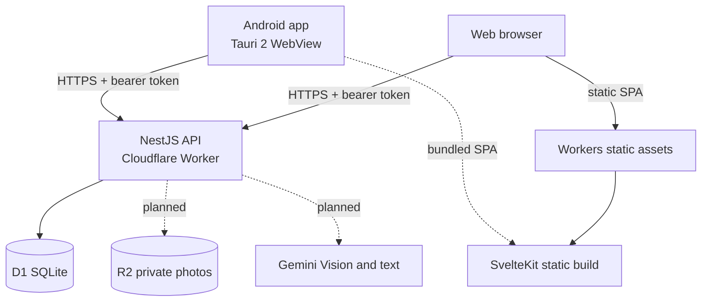

# System Architecture

Parent: [./readme.md](./readme.md) · Up: [../README.md](../README.md)

> **Updated 2026-10-29.** The app was migrated from Astro + Supabase + Vercel to a NestJS API on Cloudflare Workers, a SvelteKit static SPA and Tauri 2 for Android. Decision and rationale: [ADR-027](./decisions/027-mobile-architecture-nestjs-sveltekit-tauri.md). Order of work: [mobile migration plan](../planning/mobile-migration-plan.md). The Astro app is preserved at the git tag `pre-migration` (`git show pre-migration:src/pages/dashboard.astro`).

## Topology



The SPA is the same build for the web and for the Tauri WebView. There is no server-side rendering: the only server is the API.

## Rendering Strategy

Everything renders in the browser (`ssr = false`, `adapter-static` with an `index.html` fallback). Pages load data from the API and cache it for offline use.

| Route | State |
|-------|-------|
| `/login`, `/register` | Implemented |
| `/dashboard` (today's workout, start or continue) | Implemented |
| `/workout/[id]` (log sets, rest timer, finish; works offline) | Implemented |
| `/history` | Implemented |
| `/progress`, `/photos`, `/nutrition`, `/family`, `/settings` | Planned (migration plan, Phase 3 and the Phase 2 modules) |

## Tech Stack

| Layer | Choice | Decision |
|-------|--------|----------|
| Language | TypeScript 7 (api, contracts). TypeScript 6 in `apps/app`, because SvelteKit 3 needs the TypeScript JS API | [ADR-027](./decisions/027-mobile-architecture-nestjs-sveltekit-tauri.md) |
| Frontend | SvelteKit 3 + Svelte 5 (static SPA) | ADR-027 |
| Mobile shell | Tauri 2 (Android first) | ADR-027 |
| API | NestJS 12 on the Express adapter, built with SWC, running in a Cloudflare Worker | ADR-027 |
| Database | Cloudflare D1 (SQLite), Drizzle ORM | [ADR-012](./decisions/012-drizzle-orm.md), ADR-027 |
| Auth | Email and password, opaque bearer session token, argon2id WASM | ADR-027 section 7 |
| Shared contracts | zod 4 schemas in `packages/contracts` | ADR-027 |
| Monorepo | pnpm workspaces + Turborepo | ADR-027 |
| Offline | IndexedDB outbox, local-first workouts, read-through cache | [mobile plan, Phase 4](../planning/mobile-migration-plan.md) |
| Charts | Chart.js used directly from Svelte (planned) | supersedes [ADR-002](./decisions/002-chartjs-react-island.md) |
| Photos | Cloudflare R2, presigned URLs (planned) | supersedes the storage part of [ADR-005](./decisions/005-private-photos.md) |
| Test data | Object Mothers, real SQLite in memory, no mocks | [ADR-009](./decisions/009-object-mothers.md) |

## Project Structure

File naming: **kebab-case** throughout. See [File Naming Conventions](#file-naming-conventions).

```
gym-up/
  turbo.json  pnpm-workspace.yaml  tsconfig.base.json
  apps/
    api/                          NestJS API (Cloudflare Worker) and the domain code
      db/                         Drizzle schema, migrations, seed (db/seed.sql is generated)
      src/
        lib/contexts/<context>/   hexagonal modules: domain/, application/, infrastructure/sqlite/
        nest/                     controllers, modules, guards, pipes (the HTTP adapter)
        worker.ts                 Cloudflare entry point (lazy boot of Nest)
        worker/                   Worker-only adapters (argon2 hasher)
        vendor/argon2-wasm-edge/  vendored, patched argon2 (see its README)
      tests/                      unit tests per context + tests/nest/api.e2e.test.ts
      wrangler.jsonc              Worker, D1 binding, bundler aliases
    app/                          SvelteKit SPA + Tauri
      src/routes/                 login, register, dashboard, workout/[id], history
      src/lib/api/                typed fetch client, token store, errors
      src/lib/offline/            IndexedDB wrapper, outbox, sync loop, cache, workout snapshots
      src/lib/components/         AppNav, SyncBanner
      src-tauri/                  Tauri 2 project, with the generated Android Studio project
      wrangler.jsonc              serves build/ from Workers static assets
  packages/
    contracts/                    zod request and response schemas shared by api and app
```

Implemented contexts under `apps/api/src/lib/contexts/`: `auth`, `workout-tracking`, `progress`, `private-photos`, `public-view`, `nutrition`. Only `auth` and `workout-tracking` have Nest modules so far; the others are ported module by module (migration plan, Phase 2).

## Hexagonal Layering in `apps/api`

Per [ADR-013](./decisions/013-hexagonal-architecture.md), each context is layered and dependencies point inward:

```
nest/ (controllers, guards, pipes)  ->  application/ (use cases)  ->  domain/ (entities, ports)
                                                  ^
infrastructure/sqlite/ (Drizzle repositories) ----+  implements the ports
```

- `domain/` and `application/` do not import Nest, Drizzle or any runtime. They are plain classes.
- Repositories take the database handle as a constructor argument (`Db` type in `src/lib/db/client.ts`), so the same code runs on D1 in a Worker and on in-memory `better-sqlite3` in tests.
- Domain errors are plain `Error` subclasses mapped to HTTP statuses by `nest/common/domain-exception.filter.ts` (by `name`, because several contexts define their own `WorkoutNotFoundError`).

## File Naming Conventions

| File type | Pattern | Example |
|-----------|---------|---------|
| Context composition | `[context].composition.ts` | `auth.composition.ts` |
| Context types | `[context].types.ts` | `auth.types.ts` |
| Context constants | `[context].constants.ts` | `auth.constants.ts` |
| Entity | `[name].entity.ts` | `workout.entity.ts` |
| Port (abstract class) | `[name]-port.ts` or `[name]-repository.ts` | `workout-repository.ts` |
| Use case | `[verb-noun].use-case.ts` | `start-workout.use-case.ts` |
| Repository impl | `[storage]-[entity].repository.ts` | `sqlite-workout.repository.ts` |
| Adapter impl | `[storage]-[port].adapter.ts` | `gemini-vision.adapter.ts` |
| UI component | `[name].svelte` or `[name].tsx` | `rest-timer.svelte` |
| Test mother | `[entity].mother.ts` | `workout.mother.ts` |
| Object Mother file (kebab-case) | `[entity].mother.ts` | `workout.mother.ts` |
| Flow file | `[name].flow.md` | `start-workout.flow.md` |

All file names use **kebab-case** (lowercase with hyphens). No camelCase or PascalCase in filenames.

## Constants Pattern

All enums in TypeScript use the `as const` + derived type pattern:

```ts
// auth.constants.ts
export const AuthEvents = {
  SignedIn: 'SIGNED_IN',
  SignedOut: 'SIGNED_OUT',
  TokenRefreshed: 'TOKEN_REFRESHED',
} as const;

export type AuthEvent = (typeof AuthEvents)[keyof typeof AuthEvents];

// workout-tracking.constants.ts
export const WorkoutStatuses = {
  InProgress: 'in_progress',
  Completed: 'completed',
} as const;

export type WorkoutStatus = (typeof WorkoutStatuses)[keyof typeof WorkoutStatuses];

// user.constants.ts
export const RoutineTypes = {
  Hombre: 'hombre',
  Mujer: 'mujer',
} as const;
export type RoutineType = (typeof RoutineTypes)[keyof typeof RoutineTypes];

export const WeightUnits = {
  Kg: 'kg',
  Lbs: 'lbs',
} as const;
export type WeightUnit = (typeof WeightUnits)[keyof typeof WeightUnits];
```

**Why this pattern**:
- Runtime values preserved (can iterate, use in switch)
- TypeScript can derive literal types from `as const`
- Type and value are linked — change one, both update
- No magic strings — IDE autocomplete works
- Per-context constants file per [ADR-009](./decisions/009-object-mothers.md) naming convention

## Repository Pattern

Per [ADR-007](./decisions/007-repository-pattern.md) and [ADR-011](./decisions/011-implements-not-extends.md), every entity has an **abstract class** that defines the contract and concrete classes that `implement` it. Today there is one implementation per entity, over SQLite (`Sqlite*Repository`), used both on D1 and in tests. Use cases depend on the abstract class. No mocks: tests use real implementations with test data from Object Mothers ([ADR-009](./decisions/009-object-mothers.md)).

## Wiring: Nest Modules

[ADR-010](./decisions/010-per-context-composition.md) (per-context composition files) is replaced by **one Nest module per context**. The module binds the plain domain classes with factory providers, so the domain stays free of decorators:

```ts
// apps/api/src/nest/workouts/workouts.module.ts (abridged)
@Module({
  controllers: [WorkoutsController],
  providers: [
    { provide: WorkoutRepository, useFactory: (db: Db) => new SqliteWorkoutRepository(db), inject: [DB] },
    { provide: LogSetUseCase, useFactory: (w: WorkoutRepository) => new LogSetUseCase(w), inject: [WorkoutRepository] },
  ],
})
export class WorkoutsModule {}
```

Environment-specific dependencies (the D1 handle, the password hasher, the rate limiter) are supplied by the entry point through `AppModule.register({ db, hasher, rateLimiter })`: `src/worker.ts` in production, `tests/nest/api.e2e.test.ts` in tests. Constructor injection always uses an explicit `@Inject(token)`.

## Client-Side Storage

Ephemeral and offline state lives in IndexedDB (`apps/app/src/lib/offline/idb.ts`), not in `localStorage`:

| Store | Holds |
|-------|-------|
| `outbox` | Commands waiting to reach the server (ordered by `seq`) |
| `failed` | Commands the server rejected, kept for retry or discard |
| `kv` | `cache:<path>` copies of GET responses, `session:<id>` workout snapshots, `active-workout` pointer |

The session token is the only value in `localStorage` (`gymup.token`), behind the `TokenStore` interface so the Tauri build can move it to secure storage.

## Test Pattern

Per [ADR-009](./decisions/009-object-mothers.md), tests use Object Mothers with `@faker-js/faker`. **NO MOCKS** — only fakes (real implementations).

```ts
// apps/api/tests/workout-tracking/start-workout.use-case.test.ts
import { faker } from '@faker-js/faker';
import { WorkoutMother } from '@/test/mothers/WorkoutMother';
import { createTestDb } from '@/test/setup';

beforeEach(() => {
  const db = createTestDb(); // fresh in-memory SQLite
  // wire real SqliteXxxRepository — no mocks
});

it('creates workout', async () => {
  const userId = faker.string.uuid(); // realistic data, not 'user-1'
  const routineDayId = faker.string.uuid();
  // ... test with real SQLite
});
```

## Cross-Context Health & Safety Invariants

Rules that span multiple contexts. Enforced at composition/wiring level.

```ts
// src/lib/health-safety/health-safety.constants.ts

export const HealthRules = {
  // Sleep & recovery (cross-cuts workout + nutrition)
  MinSleepHours: 6,
  RecommendedSleepHours: 8,
  MaxSleepHours: 12,

  // Rest day rules
  MinRestDaysPerWeek: 1,
  MaxConsecutiveTrainingDays: 4,

  // Heart rate safety (workout context)
  MaxRecommendedHeartRate: 220 - 18,    // age 18 sample
  RestingHeartRateMax: 100,
  MinWorkoutHeartRate: 50,

  // Progression safety
  MaxWeightIncreasePerWeekPercent: 10,  // 10% per week (5/3/1 rule)
  MaxWeightIncreasePerSessionKg: 5,    // 5kg jump per session upper bound

  // Volume safety
  MaxWeeklyVolumeIncreasePercent: 10,
  MaxSetsPerMusclePerWeek: 20,

  // Joint recovery
  MinHoursBetweenSameMuscleGroup: 48,   // 2 days between same muscle
} as const;
```

### Invariants (cross-context)

#### Sleep & recovery
- User SHOULD sleep [`HealthRules.MinSleepHours`, `HealthRules.RecommendedSleepHours`] = [6, 8] hours per night.
- User CANNOT train more than `HealthRules.MaxConsecutiveTrainingDays` (4) days without rest day.
- User MUST have ≥ `HealthRules.MinRestDaysPerWeek` (1) rest day per week.

#### Heart rate safety (workout)
- User workout heart rate SHOULD be < `HealthRules.MaxRecommendedHeartRate` (220 - age).
- User resting heart rate SHOULD be < `HealthRules.RestingHeartRateMax` (100) bpm.

#### Progressive overload safety
- Weekly weight increase per lift MUST NOT exceed `HealthRules.MaxWeightIncreasePerWeekPercent` (10%).
- Per-session weight increase MUST NOT exceed `HealthRules.MaxWeightIncreasePerSessionKg` (5kg).
- Weekly training volume increase MUST NOT exceed `HealthRules.MaxWeeklyVolumeIncreasePercent` (10%).
- Min `HealthRules.MinHoursBetweenSameMuscleGroup` (48) hours between training same muscle.

#### Cross-context enforcement points
- `startWorkout.use-case.ts` checks consecutive training days.
- `log-set.use-case.ts` checks weight increase vs previous session.
- `nutrition-entries` POST handler checks junk food ratio (separate from workout).

---

## Frontend

SvelteKit 3 with Svelte 5 runes. Options live in `vite.config.ts` (SvelteKit 3 rejects `svelte.config.js`), the `$lib` alias is `#lib` (package.json `imports`), and `tsconfig.json` extends `$app/tsconfig`. Every API call goes through `src/lib/api/client.ts`: bearer token, a 10 s timeout, responses validated with the `packages/contracts` schemas, and a `NetworkError` that is distinct from `ApiRequestError`, so the offline logic can tell "no signal" from "rejected".

Live workouts are **local-first**: the snapshot and every set are written to IndexedDB before reaching the server, and an outbox sends them in order with exponential backoff (details in the migration plan, Phase 4). The API upserts by client-generated id, so replaying a command never duplicates data (ADR-025, amended by ADR-027 section 5).

## Deployment

- **API:** `pnpm --filter @gym-up/api deploy` builds with SWC and runs `wrangler deploy`. D1: `pnpm --filter @gym-up/api d1:migrate:remote` and `d1:seed:remote`.
- **Web:** `pnpm --filter @gym-up/app deploy:web` builds the SPA and serves it from Workers static assets (`apps/app/wrangler.jsonc`).
- **Android:** `pnpm tauri android build` in `apps/app`. Windows needs Developer Mode enabled (symlinks); see the migration plan, Phase 5.
- **Local:** `pnpm --filter @gym-up/api dev:worker` runs the API on `localhost:8787` with a local D1 (`d1:migrate:local`, `d1:seed:local`); `pnpm --filter @gym-up/app dev` runs the SPA.
- **Configuration:** the SPA reads `VITE_API_URL` (`.env.development`, `.env.production`). The API allows CORS for the Tauri origins plus the origins in `EXTRA_ORIGINS`.
