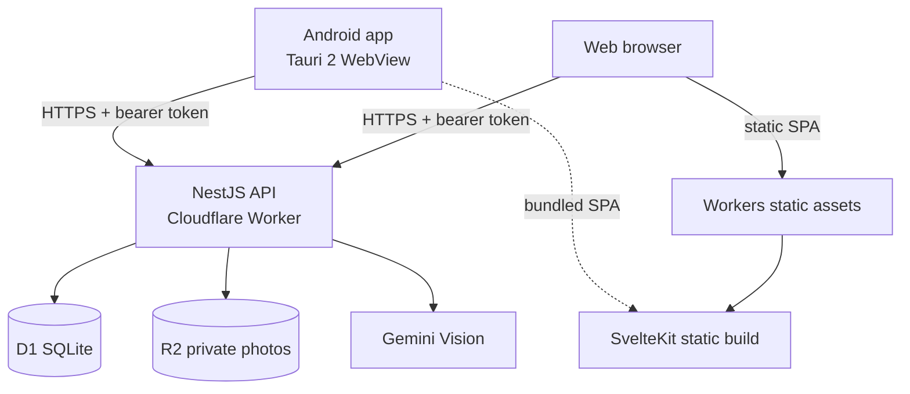
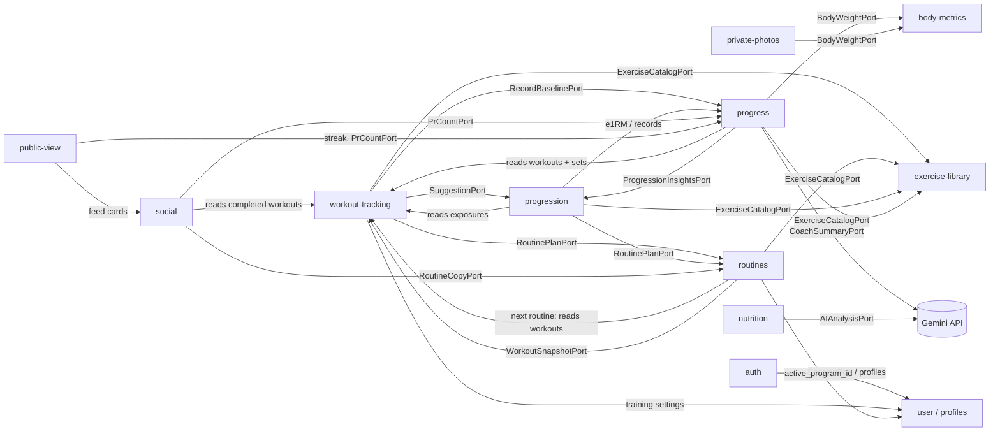

# System Architecture

Parent: [./readme.md](./readme.md) · Up: [../README.md](../README.md)

> **Updated 2026-10-29.** The app was migrated from Astro + Supabase + Vercel to a NestJS API on Cloudflare Workers, a SvelteKit static SPA and Tauri 2 for Android. Decision and rationale: [ADR-027](./decisions/027-mobile-architecture-nestjs-sveltekit-tauri.md). Order of work: [mobile migration plan](../planning/mobile-migration-plan.md). The Astro app is preserved at the git tag `pre-migration` (`git show pre-migration:src/pages/dashboard.astro`).

## Topology



The SPA is the same build for the web and for the Tauri WebView. There is no server-side rendering: the only server is the API.

## Rendering Strategy

Everything renders in the browser (`ssr = false`, `adapter-static` with an `index.html` fallback). Pages load data from the API and cache it for offline use.

| Route | State |
|-------|-------|
| `/login`, `/register` | Implemented |
| `/dashboard` (today's workout, start or continue) | Implemented |
| `/workout/[id]` (log sets, rest timer, finish; works offline) | Implemented |
| `/history` | Implemented |
| `/progress` (streak, 28-day calendar, per-exercise chart) | Implemented |
| `/family`, `/family/[id]` | Implemented |
| `/nutrition` (photo analysis or manual entry, daily summary, goal) | Implemented (analysis needs the Gemini key) |
| `/photos` (private progress photos) | Implemented (needs the R2 bucket) |
| `/settings`, `/more` | Implemented |

### Phase 2 pages (planned)

Navigation v2 tabs: Inicio · Entrenar · Progreso · Perfil ([FR-WT-044](../prd/features/workout-tracking.md#fr-wt-044), [components.md](./components.md)). Every page is a client-rendered Svelte route in `apps/app` (no SSR, [ADR-027](./decisions/027-mobile-architecture-nestjs-sveltekit-tauri.md)); the "Components" column lists the Svelte components the page needs, named as in the Phase 2 component specs. Reads go through the offline cache and writes that must survive no signal go through the outbox ([ADR-025](./decisions/025-offline-live-workout.md)).

| Page | Components | Reason / content | Story |
|------|------------|------------------|-------|
| Dashboard v2 (`/dashboard`) | `NextWorkoutCard`, `LikeButton` | Next routine, readiness/recovery, deload card, family feed. Cached for offline start | 8.3, 10.3, 10.4, 12.1 |
| Train (`/train`) | — | Programs, templates entry, empty workout, library | 8.2 |
| Templates (`/train/templates`) | — | 7 seeded templates + preview | 8.4 |
| Routine builder (`/train/routines/[id]/edit`, new) | `RoutineBuilder` | Owner only | 8.2 |
| Onboarding (`/onboarding`) | `OnboardingWizard` | Questionnaire → recommended template | 8.4 |
| Exercises (`/exercises`) | `ExercisePicker` (page variant) | Search/filter client-side over the full list; `GET /api/exercises` is served from the read-through cache | 7.3 |
| Exercise detail (`/exercises/[id]`) | `ProgressChart`/charts, `PlateauSheet` | Tabs: Cómo hacerlo, Historial, Gráficas, Récords | 7.3, 10.1, 11.2 |
| Live workout (`/workout/[id]`) | `LiveWorkout` | In progress → live island; completed → `WorkoutSummary` v2; `?mode=edit` → island in edit mode. Works offline (local snapshot and outbox) | 9.1–9.3, 12.3 |
| Workout detail (`/workouts/[id]`) | `LikeButton`, `CommentList`, `ShareImageButton` | Read-only detail for anyone (read-all) | 12.1 |
| Activity (`/activity`) | — | Likes/comments on my workouts; marks seen | 12.1 |
| History v2 (`/history`) | — | Name, duration, volume, sets, PRs; filter by program/routine | 9.3 |
| Progress v2 (`/progress`) | `WeeklyBarsChart`, `MuscleDistributionChart`, `CoachSummaryCard` | Stats, calendar, streaks, AI summary (fetched after load) | 11.2, 11.4 |
| Profile (`/profile`) | — | Hub: history, measurements, photos, nutrition, tools, export, settings | 9.4 |
| Measurements (`/profile/measurements`, `/new`) | `MeasurementChart` | Owner-only body metrics | 11.1 |
| Tools (`/profile/tools`) | `OneRmCalculator` | 1RM calculator | 9.5 |
| Photo compare (`/photos/compare`) | `PhotoCompare` | Owner-only | 11.3 |
| Family member (`/family/[user_id]`) | `LikeButton` | Workouts list via feed cards | 12.1 |
| Settings (`/settings`) | — | Adds *Entrenamiento* (FR-WT-037) and *Cambiar programa* | 9.4 |

Decisions: `/onboarding` is the questionnaire route, and `/profile/tools` hosts the 1RM calculator (PRDs name the screens but not the paths). Implemented today: `/dashboard`, `/workout/[id]`, `/history`, `/progress`, `/family`, `/settings`, `/photos`, `/nutrition`, `/more` (Phase 1 behavior, see [components.md](./components.md)); the Phase 2 versions replace them as their stories land.

## Tech Stack

| Layer | Choice | Decision |
|-------|--------|----------|
| Language | TypeScript 7 (api, contracts). TypeScript 6 in `apps/app`, because SvelteKit 3 needs the TypeScript JS API | [ADR-027](./decisions/027-mobile-architecture-nestjs-sveltekit-tauri.md) |
| Frontend | SvelteKit 3 + Svelte 5 (static SPA) | ADR-027 |
| Mobile shell | Tauri 2 (Android first) | ADR-027 |
| API | NestJS 12 on the Express adapter, built with SWC, running in a Cloudflare Worker | ADR-027 |
| Database | Cloudflare D1 (SQLite), Drizzle ORM | [ADR-012](./decisions/012-drizzle-orm.md), ADR-027 |
| Auth | Email and password, opaque bearer session token, argon2id WASM | ADR-027 section 7 |
| Shared contracts | zod 4 schemas in `packages/contracts` | ADR-027 |
| Monorepo | pnpm workspaces + Turborepo | ADR-027 |
| Offline | IndexedDB outbox, local-first workouts, read-through cache | [mobile plan, Phase 4](../planning/mobile-migration-plan.md) |
| Charts | Chart.js used directly from Svelte | supersedes [ADR-002](./decisions/002-chartjs-react-island.md) |
| Photos | Cloudflare R2 through the Worker binding; bytes go through the owner-checked API, no presigned URLs | supersedes the storage part of [ADR-005](./decisions/005-private-photos.md) |
| Test data | Object Mothers, real SQLite in memory, no mocks | [ADR-009](./decisions/009-object-mothers.md) |

## Project Structure

File naming: **kebab-case** throughout. See [File Naming Conventions](#file-naming-conventions).

```
gym-up/
  turbo.json  pnpm-workspace.yaml  tsconfig.base.json
  apps/
    api/                          NestJS API (Cloudflare Worker) and the domain code
      db/                         Drizzle schema, migrations, seed (db/seed.sql is generated)
      src/
        lib/contexts/<context>/   hexagonal modules: domain/, application/, infrastructure/sqlite/
        nest/                     controllers, modules, guards, pipes (the HTTP adapter)
        worker.ts                 Cloudflare entry point (lazy boot of Nest)
        worker/                   Worker-only adapters (argon2 hasher)
        vendor/argon2-wasm-edge/  vendored, patched argon2 (see its README)
      tests/                      unit tests per context + tests/nest/api.e2e.test.ts
      wrangler.jsonc              Worker, D1 binding, bundler aliases
    app/                          SvelteKit SPA + Tauri
      src/routes/                 login, register, dashboard, workout/[id], history
      src/lib/api/                typed fetch client, token store, errors
      src/lib/offline/            IndexedDB wrapper, outbox, sync loop, cache, workout snapshots
      src/lib/components/         AppNav, SyncBanner
      src-tauri/                  Tauri 2 project, with the generated Android Studio project
      wrangler.jsonc              serves build/ from Workers static assets
  packages/
    contracts/                    zod request and response schemas shared by api and app
```

Implemented contexts under `apps/api/src/lib/contexts/`: `auth`, `workout-tracking`, `progress`, `private-photos`, `public-view`, `nutrition`. Every context has a Nest module: `auth`, `workout-tracking`, `progress`, `public-view` (served as `/family`), `private-photos` and `nutrition`.

## Hexagonal Layering in `apps/api`

Per [ADR-013](./decisions/013-hexagonal-architecture.md), each context is layered and dependencies point inward:

```
nest/ (controllers, guards, pipes)  ->  application/ (use cases)  ->  domain/ (entities, ports)
                                                  ^
infrastructure/sqlite/ (Drizzle repositories) ----+  implements the ports
```

- `domain/` and `application/` do not import Nest, Drizzle or any runtime. They are plain classes.
- Repositories take the database handle as a constructor argument (`Db` type in `src/lib/db/client.ts`), so the same code runs on D1 in a Worker and on in-memory `better-sqlite3` in tests.
- Domain errors are plain `Error` subclasses mapped to HTTP statuses by `nest/common/domain-exception.filter.ts` (by `name`, because several contexts define their own `WorkoutNotFoundError`).

## File Naming Conventions

| File type | Pattern | Example |
|-----------|---------|---------|
| Context composition | `[context].composition.ts` | `auth.composition.ts` |
| Context types | `[context].types.ts` | `auth.types.ts` |
| Context constants | `[context].constants.ts` | `auth.constants.ts` |
| Entity | `[name].entity.ts` | `workout.entity.ts` |
| Port (abstract class) | `[name]-port.ts` or `[name]-repository.ts` | `workout-repository.ts` |
| Use case | `[verb-noun].use-case.ts` | `start-workout.use-case.ts` |
| Repository impl | `[storage]-[entity].repository.ts` | `sqlite-workout.repository.ts` |
| Adapter impl | `[storage]-[port].adapter.ts` | `gemini-vision.adapter.ts` |
| UI component | `[name].svelte` or `[name].tsx` | `rest-timer.svelte` |
| Test mother | `[entity].mother.ts` | `workout.mother.ts` |
| Object Mother file (kebab-case) | `[entity].mother.ts` | `workout.mother.ts` |
| Flow file | `[name].flow.md` | `start-workout.flow.md` |

All file names use **kebab-case** (lowercase with hyphens). No camelCase or PascalCase in filenames.

## Constants Pattern

All enums in TypeScript use the `as const` + derived type pattern:

```ts
// auth.constants.ts
export const AuthEvents = {
  SignedIn: 'SIGNED_IN',
  SignedOut: 'SIGNED_OUT',
  TokenRefreshed: 'TOKEN_REFRESHED',
} as const;

export type AuthEvent = (typeof AuthEvents)[keyof typeof AuthEvents];

// workout-tracking.constants.ts
export const WorkoutStatuses = {
  InProgress: 'in_progress',
  Completed: 'completed',
} as const;

export type WorkoutStatus = (typeof WorkoutStatuses)[keyof typeof WorkoutStatuses];

// user.constants.ts
export const RoutineTypes = {
  Hombre: 'hombre',
  Mujer: 'mujer',
} as const;
export type RoutineType = (typeof RoutineTypes)[keyof typeof RoutineTypes];

export const WeightUnits = {
  Kg: 'kg',
  Lbs: 'lbs',
} as const;
export type WeightUnit = (typeof WeightUnits)[keyof typeof WeightUnits];
```

**Why this pattern**:
- Runtime values preserved (can iterate, use in switch)
- TypeScript can derive literal types from `as const`
- Type and value are linked — change one, both update
- No magic strings — IDE autocomplete works
- Per-context constants file per [ADR-009](./decisions/009-object-mothers.md) naming convention

## Repository Pattern

Per [ADR-007](./decisions/007-repository-pattern.md) and [ADR-011](./decisions/011-implements-not-extends.md), every entity has an **abstract class** that defines the contract and concrete classes that `implement` it. Today there is one implementation per entity, over SQLite (`Sqlite*Repository`), used both on D1 and in tests. Use cases depend on the abstract class. No mocks: tests use real implementations with test data from Object Mothers ([ADR-009](./decisions/009-object-mothers.md)).

## Wiring: Nest Modules

[ADR-010](./decisions/010-per-context-composition.md) (per-context composition files) is replaced by **one Nest module per context**. The module binds the plain domain classes with factory providers, so the domain stays free of decorators:

```ts
// apps/api/src/nest/workouts/workouts.module.ts (abridged)
@Module({
  controllers: [WorkoutsController],
  providers: [
    { provide: WorkoutRepository, useFactory: (db: Db) => new SqliteWorkoutRepository(db), inject: [DB] },
    { provide: LogSetUseCase, useFactory: (w: WorkoutRepository) => new LogSetUseCase(w), inject: [WorkoutRepository] },
  ],
})
export class WorkoutsModule {}
```

Environment-specific dependencies (the D1 handle, the password hasher, the rate limiter) are supplied by the entry point through `AppModule.register({ db, hasher, rateLimiter })`: `src/worker.ts` in production, `tests/nest/api.e2e.test.ts` in tests. Constructor injection always uses an explicit `@Inject(token)`.

## Client-Side Storage

Ephemeral and offline state lives in IndexedDB (`apps/app/src/lib/offline/idb.ts`), not in `localStorage`:

| Store | Holds |
|-------|-------|
| `outbox` | Commands waiting to reach the server (ordered by `seq`) |
| `failed` | Commands the server rejected, kept for retry or discard |
| `kv` | `cache:<path>` copies of GET responses, `session:<id>` workout snapshots, `active-workout` pointer |

The session token is the only value in `localStorage` (`gymup.token`), behind the `TokenStore` interface so the Tauri build can move it to secure storage.

## Test Pattern

Per [ADR-009](./decisions/009-object-mothers.md), tests use Object Mothers with `@faker-js/faker`. **NO MOCKS** — only fakes (real implementations).

```ts
// apps/api/tests/workout-tracking/start-workout.use-case.test.ts
import { faker } from '@faker-js/faker';
import { WorkoutMother } from '@/test/mothers/WorkoutMother';
import { createTestDb } from '@/test/setup';

beforeEach(() => {
  const db = createTestDb(); // fresh in-memory SQLite
  // wire real SqliteXxxRepository — no mocks
});

it('creates workout', async () => {
  const userId = faker.string.uuid(); // realistic data, not 'user-1'
  const routineDayId = faker.string.uuid();
  // ... test with real SQLite
});
```

## Cross-Context Health & Safety Invariants

Rules that span multiple contexts. Enforced at composition/wiring level.

```ts
// src/lib/health-safety/health-safety.constants.ts

export const HealthRules = {
  // Sleep & recovery (cross-cuts workout + nutrition)
  MinSleepHours: 6,
  RecommendedSleepHours: 8,
  MaxSleepHours: 12,

  // Rest day rules
  MinRestDaysPerWeek: 1,
  MaxConsecutiveTrainingDays: 4,

  // Heart rate safety (workout context)
  MaxRecommendedHeartRate: 220 - 18,    // age 18 sample
  RestingHeartRateMax: 100,
  MinWorkoutHeartRate: 50,

  // Progression safety
  MaxWeightIncreasePerWeekPercent: 10,  // 10% per week (5/3/1 rule)
  MaxWeightIncreasePerSessionKg: 5,    // 5kg jump per session upper bound

  // Volume safety
  MaxWeeklyVolumeIncreasePercent: 10,
  MaxSetsPerMusclePerWeek: 20,

  // Joint recovery
  MinHoursBetweenSameMuscleGroup: 48,   // 2 days between same muscle
} as const;
```

### Invariants (cross-context)

#### Sleep & recovery
- User SHOULD sleep [`HealthRules.MinSleepHours`, `HealthRules.RecommendedSleepHours`] = [6, 8] hours per night.
- User CANNOT train more than `HealthRules.MaxConsecutiveTrainingDays` (4) days without rest day.
- User MUST have ≥ `HealthRules.MinRestDaysPerWeek` (1) rest day per week.

#### Heart rate safety (workout)
- User workout heart rate SHOULD be < `HealthRules.MaxRecommendedHeartRate` (220 - age).
- User resting heart rate SHOULD be < `HealthRules.RestingHeartRateMax` (100) bpm.

#### Progressive overload safety
- Weekly weight increase per lift MUST NOT exceed `HealthRules.MaxWeightIncreasePerWeekPercent` (10%).
- Per-session weight increase MUST NOT exceed `HealthRules.MaxWeightIncreasePerSessionKg` (5kg).
- Weekly training volume increase MUST NOT exceed `HealthRules.MaxWeeklyVolumeIncreasePercent` (10%).
- Min `HealthRules.MinHoursBetweenSameMuscleGroup` (48) hours between training same muscle.

#### Cross-context enforcement points
- `startWorkout.use-case.ts` checks consecutive training days.
- `log-set.use-case.ts` checks weight increase vs previous session.
- `nutrition-entries` POST handler checks junk food ratio (separate from workout).

### Phase 2: HealthRules guide, they never block logging

Phase 2 keeps the `HealthRules` values but changes **where** they apply ([ADR-016 §5](./decisions/016-workout-data-model-v2.md)). A user may always log what they actually lifted. The MUST/CANNOT wording above becomes, for workout data:

| Rule | Phase 2 enforcement point | Effect |
|---|---|---|
| `MaxWeightIncreasePerSessionKg` (5 kg), `MaxWeightIncreasePerWeekPercent` (10 %) | progression engine, **suggestions only** ([ADR-021 §4](./decisions/021-progression-engine.md)) | Caps the suggested increase (min one increment step) |
| `MaxConsecutiveTrainingDays` (4) | progression soft warning "Días seguidos" ([ADR-022 §3](./decisions/022-readiness-and-recovery.md)) | Dismissible dashboard banner |
| `MaxSetsPerMusclePerWeek` (20) | progression soft warning "Volumen alto" + muscle distribution flag ([FR-PR-015](../prd/features/progress.md#fr-pr-015)) | Warning, never blocks |
| `MinHoursBetweenSameMuscleGroup` (48 h) | recovery window ([ADR-022 §2](./decisions/022-readiness-and-recovery.md)) | "Músculo fatigado" in the readiness step and routine picker |
| `MinRestDaysPerWeek` (1) | no screen (rest-day screens removed, [ADR-019](./decisions/019-rotation-scheduling-and-onboarding.md)); covered by the consecutive-days warning | — |

`StartWorkoutUseCase` and the set use cases no longer check any of these (the two Phase 1 enforcement points above are retired in stories 9.1 / 9.2). The only hard session rule left is "≥ 1 completed set to finish".

---

## Offline

[ADR-025](./decisions/025-offline-live-workout.md), amended by ADR-027 section 5: **no service worker and no PWA manifest**. The app is a static SPA bundled into the Tauri build (the web build is just a convenience), so the shell is always present; only data needs an offline strategy. Status of each piece (2026-10-29):

| Piece | Where | State |
|---|---|---|
| Client IDs | every client-created workout, set and meal gets `crypto.randomUUID()`; endpoints are idempotent upserts by id | Done for workouts, sets, meals and photos |
| Outbox | IndexedDB `gymup` store `outbox` (`seq`, `command`, `attempts`, `nextAttemptAt`); `failed` store for rejected commands | Done: `start-workout`, `upsert-set`, `finish-workout`. Phase 2 commands (`add-exercise`, `update-exercise`, `remove-exercise`, `reorder-exercises`, `delete-set`, `discard-workout`) are added with their stories |
| Sync loop | `apps/app/src/lib/offline/sync.svelte.ts` | Done: drains in `seq` order, one command at a time, on `online`, on return to the foreground, after every enqueue and every 15 s while something is pending; exponential backoff from 1 s to 5 min |
| Error handling | `outbox.ts` | Done: network and 5xx retry, 401 pauses without losing commands, other 4xx move to `failed` with Retry and Discard in the UI |
| Coalescing and remap | `outbox.ts` | Done: repeated edits of one set collapse into one command; a server answer to `start-workout` with another workout (one per user per day) rewrites the queued commands |
| Session snapshot | IndexedDB `kv`, key `session:<id>` | Done: the open workout is persisted on every action, so a reload restores it without the network |
| Read-through cache | `offline/cache.ts`, key `cache:<path>` | Done for today's routine, history, progress, family, nutrition and the current user; replaces the service worker's runtime caching |
| Offline start | dashboard | Done: starts from the last downloaded routine; the plan and previous values are one session old |
| Conflicts | server | **Deferred.** Last-write-wins by `updated_at` and 30-day tombstones apply to a workout edited on two devices; today one device edits a workout at a time and the natural keys (`exerciseId` + `setNumber`) make replays safe |

## Phase 2 Context Map

Arrows point from the consumer to the provider. Labels are the ports the consumer depends on ([ADR-013](./decisions/013-hexagonal-architecture.md)). Each port is declared and implemented by the **provider** and exported from its composition root ([contexts/readme.md → Cross-context ports](./contexts/readme.md#cross-context-ports-phase-2)). "reads" means the consumer's own repository queries the provider's tables through a read model (Phase 1 pattern of `progress` and `public-view`); no cross-context writes exist.



| Context | Owns (tables) | Docs |
|---|---|---|
| auth | sessions | [contexts/auth](./contexts/auth/readme.md) |
| user | `profiles` identity fields | [contexts/user](./contexts/user/readme.md) |
| workout-tracking | `workouts`, `workout_exercises`, `workout_entries`, profile training settings | [contexts/workout-tracking](./contexts/workout-tracking/readme.md#phase-2) |
| exercise-library | `exercises` | [contexts/exercise-library](./contexts/exercise-library/readme.md), [ADR-017](./decisions/017-exercise-catalog.md) |
| routines | `routines`, `routine_days`, `routine_exercises`, `profiles.active_program_id` + onboarding answers | [contexts/routines](./contexts/routines/readme.md), [ADR-018](./decisions/018-user-owned-programs.md), [ADR-019](./decisions/019-rotation-scheduling-and-onboarding.md) |
| progression | `exercise_progression_overrides`, `readiness_checkins`, deload columns | [contexts/progression](./contexts/progression/readme.md), [ADR-021](./decisions/021-progression-engine.md), [ADR-022](./decisions/022-readiness-and-recovery.md) |
| progress | derived stats and records (no record table), `ai_weekly_summaries` | [contexts/progress](./contexts/progress/readme.md), [ADR-020](./decisions/020-personal-records.md), [ADR-026](./decisions/026-weekly-ai-coach-summary.md) |
| body-metrics | `body_measurements` (owner-only) | [contexts/body-metrics](./contexts/body-metrics/readme.md), [ADR-023](./decisions/023-body-metrics-privacy.md) |
| public-view | read models only | [contexts/public-view](./contexts/public-view/readme.md) |
| social | `workout_likes`, `workout_comments`, `profiles.activity_seen_at` | [contexts/social](./contexts/social/readme.md), [ADR-024](./decisions/024-social-interactions.md) |
| private-photos | `progress_photos` + storage (owner-only) | [contexts/private-photos](./contexts/private-photos/readme.md) |
| nutrition | `nutrition_entries`, `nutrition_goals` | [contexts/nutrition](./contexts/nutrition/readme.md) |

Port names not yet fixed by an ADR (the "reads …" edges) are defined in the consumer's context readme. Privacy edges never cross users: body metrics, readiness, overrides, AI summaries, photos and nutrition stay owner-only ([FR-PV-009](../prd/features/public-view.md#fr-pv-009)).

## Frontend

SvelteKit 3 with Svelte 5 runes. Options live in `vite.config.ts` (SvelteKit 3 rejects `svelte.config.js`), the `$lib` alias is `#lib` (package.json `imports`), and `tsconfig.json` extends `$app/tsconfig`. Every API call goes through `src/lib/api/client.ts`: bearer token, a 10 s timeout, responses validated with the `packages/contracts` schemas, and a `NetworkError` that is distinct from `ApiRequestError`, so the offline logic can tell "no signal" from "rejected".

Live workouts are **local-first**: the snapshot and every set are written to IndexedDB before reaching the server, and an outbox sends them in order with exponential backoff (details in the migration plan, Phase 4). The API upserts by client-generated id, so replaying a command never duplicates data (ADR-025, amended by ADR-027 section 5).

## Deployment

- **API:** `pnpm --filter @gym-up/api deploy` builds with SWC and runs `wrangler deploy`. D1: `pnpm --filter @gym-up/api d1:migrate:remote` and `d1:seed:remote`.
- **Web:** `pnpm --filter @gym-up/app deploy:web` builds the SPA and serves it from Workers static assets (`apps/app/wrangler.jsonc`).
- **Android:** `pnpm --filter @gym-up/app android:debug` builds and installs a debug APK on the connected phone (it works around the Windows symlink restriction; with Developer Mode on, `pnpm tauri android build --debug --apk --target aarch64` also works). Needs Rust, the Android SDK and NDK, and `ANDROID_HOME`/`NDK_HOME`; see the migration plan, Phase 5.
- **Local:** `pnpm --filter @gym-up/api dev:worker` runs the API on `localhost:8787` with a local D1 (`d1:migrate:local`, `d1:seed:local`); `pnpm --filter @gym-up/app dev` runs the SPA.
- **Cloud steps that need your accounts (R2 bucket, Gemini key, rate limiting, release signing):** [cloud-setup-pending](../planning/cloud-setup-pending.md).
- **Configuration:** the SPA reads `VITE_API_URL` (`.env.development`, `.env.production`). The API allows CORS for the Tauri origins plus the origins in `EXTRA_ORIGINS`.
