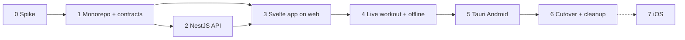

# Mobile Migration Plan

Parent: [./readme.md](./readme.md) · Up: [../README.md](../README.md)

Executes [ADR-027](../architecture/decisions/027-mobile-architecture-nestjs-sveltekit-tauri.md): NestJS API, SvelteKit static SPA, Tauri 2 (Android first). Strangler approach: the current Astro app keeps working until the new stack reaches parity and is cut over.

Effort is relative (S ≤ a few days, M ≈ 1–2 weeks, L ≈ several weeks) and has not been measured.

## Phase overview

## Phase 0 — Spike and environment (S)

Goal: prove the risky parts before committing.

- Install toolchains on the Windows dev machine: Rust (`rustup`), Android Studio (SDK, NDK, platform tools), JDK, `ANDROID_HOME`, Rust Android targets.
- Hello-world SvelteKit static + Tauri 2 running on a physical Android device with `tauri android dev` and Vite HMR over USB or Wi-Fi (`TAURI_DEV_HOST`).
- Fetch a request from the app to a stub server (verifies CORS and the Android cleartext/HTTPS rules).
- Open IndexedDB from the webview and write/read a record.
- Install the latest versions in the ADR table together; record any peer-dependency conflicts as ADR exceptions.
- **Cloudflare gate (platform chosen; this validates it).** Done on 2026-10-29: Nest 12 + Express built with SWC, deployed, Drizzle on D1, `db.batch` atomic, startup 50–58 ms in two runs, and the real `complete-workout` use case, repository and migrations ran unchanged on D1 (see ADR-027 spike results). **Still open:** R2 presigned upload, an adequate password hash on Workers (WebCrypto PBKDF2 is capped at 100k iterations), and a spike with a real module (for example `complete-workout`). Fallbacks: Hono on Workers, or Nest on a Node host.

Exit: all of the above run on a deployed Worker; version exceptions documented. If the gate fails, switch to the ADR-027 fallback (Hono on Workers keeping the hexagonal domain, or Nest on a Node host) before Phase 1.

## Phase 1 — Monorepo and contracts (S)

- Convert the existing repo (`Alefrankie/gym-up`) to a pnpm workspace with **Turborepo**: `apps/api`, `apps/app`, `packages/contracts`, and a `turbo.json` task graph (`build`, `dev`, `lint`, `typecheck`, `test`) with caching. Keep the Astro app running in place until Phase 6. Work on branches and PRs; use the `Alefrankie` GitHub account for `gh`.
- `packages/contracts`: zod schemas and inferred types for the existing endpoints (`/api/workouts`, `/api/workout-entries`, `/api/workouts/:id/complete`, `/api/photos`, `/api/nutrition/*`) plus auth.
- Shared lint, `tsconfig` base and Vitest config. Move `db/schema.ts` and migrations under `apps/api`.

Exit: workspace installs and builds; contracts compile in both apps.

## Phase 2 — NestJS API, module by module (L)

Port `domain` and `application` code unchanged; write Nest controllers, providers and Drizzle repositories. Keep the existing unit tests and Object Mothers ([ADR-009](../architecture/decisions/009-object-mothers.md)) and run them against the moved code.

| Order | Module | Notes |
|-------|--------|-------|
| 2.1 | `auth` | Email and password (as today) issuing an opaque bearer session token; auth guard, CORS. Password hash per ADR-027 open question 2. |
| 2.2 | `workout-tracking` | Idempotent upserts by client UUID, `updated_at` LWW, tombstones ([ADR-025](../architecture/decisions/025-offline-live-workout.md) §3, §5). Includes profile and routines read paths used today. |
| 2.3 | `progress` | Read-only aggregations, easiest to contract-test. |
| 2.4 | `private-photos` | R2 bucket, presigned URLs, owner-only, 5 per workout ([ADR-005](../architecture/decisions/005-private-photos.md)). |
| 2.5 | `nutrition` | Gemini adapter ([ADR-014](../architecture/decisions/014-ai-nutrition-analysis.md)); key only in API env. Rate limit. |
| 2.6 | `public-view` | Family feed and member pages; respects RLS-equivalent rules ([ADR-004](../architecture/decisions/004-rls-visibility.md)). |

Per module: contract tests against `packages/contracts`, OpenAPI published, and a comparison run of old Astro endpoint versus new Nest endpoint on the same fixtures.

Deploy the API to the chosen platform as soon as 2.1 and 2.2 exist, so the app is always tested against a real server.

Exit: every Phase 1 endpoint has a Nest equivalent with passing contract tests; API deployed.

## Phase 3 — SvelteKit app running on the web (L)

Build in the browser first. Tauri is not involved yet.

1. SvelteKit + `adapter-static`, `ssr = false`, app layout, bottom navigation (replaces `navigation.astro`, `app-layout.astro`).
2. API client: bearer token, one-shot refresh, typed with contracts, IndexedDB read-through cache.
3. Pages in this order, easiest to hardest. Each page replaces one Astro page or component:

| Order | Svelte page | Replaces | Size |
|-------|-------------|----------|------|
| 3.1 | Login, register, logout | `login`, `register`, `logout`, `auth-form` | S |
| 3.2 | Settings | `settings` | S |
| 3.3 | History | `history`, `workout-summary`, `calendar-grid`, `streak-counter` | M |
| 3.4 | Dashboard | `dashboard` | M |
| 3.5 | Progress | `progress`, `progress-chart.tsx` (Chart.js direct) | M |
| 3.6 | Family and member | `family`, `family/[user_id]`, `family-member-card` | M |
| 3.7 | Photos | `photos`, `photo-gallery`, `photo-upload` | M |
| 3.8 | Nutrition | `nutrition`, `meal-photo-capture`, `nutrition-result`, `nutrition-history`, `daily-calorie-bar` | M |

Exit: all pages except the workout screen work in the browser against the Nest API.

## Phase 4 — Live workout and offline (L)

The riskiest UI work, done after the app shell is proven.

- Svelte rune store with reducer for the live workout ([ADR-015](../architecture/decisions/015-live-workout-react-island.md) behavior preserved), replacing `workout/[id].astro`, `exercise-card.astro` and `rest-timer.tsx`.
- Outbox in IndexedDB (`outbox`, `outbox_failed`, `sessions`), sync worker (`online`, 15 s interval, `visibilitychange`), exponential backoff, failed-command banner.
- Offline start from the cached next routine; read-through cache for the exercise and routine reads.
- Playwright test with `context.setOffline(true)` for log, edit, delete, finish, reload and resync.

Exit: a full workout can be logged offline, the app reloaded, and data syncs once without duplicates.

## Phase 5 — Tauri 2 on Android (M)

- Add `src-tauri` to `apps/app`; `tauri android init`; app id, name, icons, splash.
- `platform` module with web and Tauri implementations: camera or file pick for photos, local notifications for rest timer end, haptics, secure token storage (ADR-027 open question 3).
- Capabilities and Android permissions (camera, notifications, network).
- CORS allow-list for `tauri://localhost` and `http://tauri.localhost`; HTTPS API only for release builds.
- Debug APK on a real device end to end: login, workout offline, photo, nutrition.
- Release build: keystore, signed AAB, Play Console internal testing track.
- Remote push is out of scope for this release; only local notifications. If a blocking Tauri gap appears, fall back to Capacitor for the shell only; the Svelte app and the API are unaffected.

Exit: signed AAB installs from the internal track and passes the manual checklist below.

## Phase 6 — Cutover and cleanup (S)

- Data migration of existing SQLite data to the production DB (D1 if Cloudflare is adopted), and rehashing passwords if the hash changes (ADR-027 open question 2).
- Point the web domain at the SvelteKit build on Workers; retire the Astro app, `@astrojs/*`, `@astrojs/vercel`, `@supabase/supabase-js`, `better-sqlite3` and the `supabase/` folder.
- Remove `src/pages`, `src/components`, `src/layouts`; move or delete `src/lib/contexts` once ported.
- Mark ADR-001, ADR-002, ADR-015 superseded and ADR-025 partially superseded; accept ADR-027; update `docs/architecture/system.md` and `components.md`.

## Phase 7 — iOS (later)

Needs a Mac, Xcode and an Apple Developer account. Same app, `tauri ios init`, platform module for iOS permissions. Not scheduled.

## Phase 2 product work (decided: build in the new stack)

Routines, exercise library, progression, body metrics and social exist as docs only. Decided 2026-10-29: implement them directly in Nest and Svelte, never in Astro. They follow Phase 4 as feature modules (Nest module + Svelte pages + contracts) using the same pattern as Phases 2 and 3. Phase 2 feature delivery is paused until then; stories in `docs/stories/phase-2` are re-scoped to the new stack.

## Manual Android checklist (Phase 5 exit)

- [ ] Install, login, kill app, reopen: session persists
- [ ] Airplane mode: start workout from next routine, log sets, reload app, finish
- [ ] Reconnect: outbox drains, no duplicate sets on the server
- [ ] Rest timer notification fires with the screen off
- [ ] Take and upload a progress photo; it appears via signed URL; not visible to family
- [ ] Nutrition photo returns an estimate
- [ ] Charts render at phone width; back button behaves

## Risks

| Risk | Mitigation |
|------|------------|
| Latest majors (Nest 12, Kit 3, Vite 8, TypeScript 7) have ecosystem gaps | Phase 0 installs them together; document exceptions; pin exact versions |
| Tauri mobile plugin gaps (camera control, deep-link OAuth) | Phase 0 and Phase 5 spikes; Capacitor shell fallback |
| NestJS on Cloudflare Workers is not a mainstream path; D1 has no interactive transactions | Phase 0 gate on a real deployment; fallback to Hono on Workers or Nest on a Node host |
| Live workout rewrite regresses behavior | Port ADR-015 reducer tests first; keep Astro version until parity |
| Rust and Android toolchain friction on Windows | Do Phase 0 first; use physical device over USB |
| Feature delivery pauses during migration | Accepted; Phase 2 features built once in the new stack |
