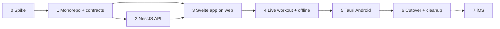

# Mobile Migration Plan

Parent: [./readme.md](./readme.md) · Up: [../README.md](../README.md)

Executes [ADR-027](../architecture/decisions/027-mobile-architecture-nestjs-sveltekit-tauri.md): NestJS API, SvelteKit static SPA, Tauri 2 (Android first). Astro is removed in Phase 1 (everything becomes SvelteKit); there are no production users, so there is no parallel-run period. The `pre-migration` git tag is the behavioral reference.

Effort is relative (S ≤ a few days, M ≈ 1–2 weeks, L ≈ several weeks) and has not been measured.

## Phase overview

## Phase 0 — Spike and environment (S)

Goal: prove the risky parts before committing.

- Install toolchains on the Windows dev machine: Rust (`rustup`), Android Studio (SDK, NDK, platform tools), JDK, `ANDROID_HOME`, Rust Android targets.
- Hello-world SvelteKit static + Tauri 2 running on a physical Android device with `tauri android dev` and Vite HMR over USB or Wi-Fi (`TAURI_DEV_HOST`).
- Fetch a request from the app to a stub server (verifies CORS and the Android cleartext/HTTPS rules).
- Open IndexedDB from the webview and write/read a record.
- Install the latest versions in the ADR table together; record any peer-dependency conflicts as ADR exceptions.
- **Cloudflare gate (platform chosen; this validates it).** Done on 2026-10-29: Nest 12 + Express built with SWC, deployed, Drizzle on D1, `db.batch` atomic, startup 50–58 ms in two runs, and the real `complete-workout` use case, repository and migrations ran unchanged on D1 (see ADR-027 spike results). **Still open:** R2 presigned upload, and authentication end to end. The password hash is decided (ADR-027 section 7, argon2id WASM with a shared instance). Fallbacks: Hono on Workers, or Nest on a Node host.

Exit: all of the above run on a deployed Worker; version exceptions documented. If the gate fails, switch to the ADR-027 fallback (Hono on Workers keeping the hexagonal domain, or Nest on a Node host) before Phase 1.

## Phase 1 — Monorepo and contracts (S)

- Convert the existing repo (`Alefrankie/gym-up`) to a pnpm workspace with **Turborepo**: `apps/api`, `apps/app`, `packages/contracts`, and a `turbo.json` task graph (`build`, `dev`, `lint`, `typecheck`, `test`) with caching. Work on branches and PRs; use the `Alefrankie` GitHub account for `gh`.
- **Tag and remove Astro.** Tag the current `main` commit `pre-migration` and push the tag before any change. Then delete `src/pages`, `src/components`, `src/layouts`, `src/styles`, `astro.config.mjs`, `astro`, `@astrojs/*`, the Vercel adapter, `react`, `react-dom` and `react-chartjs-2`. Static assets from `public/` move to `apps/app`.
- **Move the backend code** into `apps/api`: `src/lib/contexts/*`, `tests/`, `db/schema.ts` and `db/migrations`. Delete the Supabase repositories, `src/lib/supabase`, the `STORAGE_BACKEND` switch and `supabase/`. Rewrite `db/client.ts` and `env.ts` for D1. Decide the test database: keep the in-memory SQLite driver as a test-only dependency, or run tests on D1 through Miniflare.
- `packages/contracts`: zod schemas and inferred types for the existing endpoints (`/api/workouts`, `/api/workout-entries`, `/api/workouts/:id/complete`, `/api/photos`, `/api/nutrition/*`) plus auth.
- Shared lint, `tsconfig` base and Vitest config.

Exit: workspace installs and builds; contracts compile in both apps; the moved use-case tests pass in `apps/api`; no Astro code or dependency remains on the branch.

## Phase 2 — NestJS API, module by module (L)

Port `domain` and `application` code unchanged; write Nest controllers, providers and Drizzle repositories. Keep the existing unit tests and Object Mothers ([ADR-009](../architecture/decisions/009-object-mothers.md)) and run them against the moved code.

| Order | Module | Notes |
|-------|--------|-------|
| 2.1 | `auth` | Email and password (as today) issuing an opaque bearer session token; auth guard, CORS. Password hash: argon2id WASM, OWASP parameters, one shared instance, with the equivalence and known-answer tests from ADR-027 section 7; login rate limiting. |
| 2.2 | `workout-tracking` | Idempotent upserts by client UUID, `updated_at` LWW, tombstones ([ADR-025](../architecture/decisions/025-offline-live-workout.md) §3, §5). Includes profile and routines read paths used today. |
| 2.3 | `progress` | Read-only aggregations, easiest to contract-test. |
| 2.4 | `private-photos` | R2 bucket, presigned URLs, owner-only, 5 per workout ([ADR-005](../architecture/decisions/005-private-photos.md)). |
| 2.5 | `nutrition` | Gemini adapter ([ADR-014](../architecture/decisions/014-ai-nutrition-analysis.md)); key only in API env. Rate limit. |
| 2.6 | `public-view` | Family feed and member pages; respects RLS-equivalent rules ([ADR-004](../architecture/decisions/004-rls-visibility.md)). |

**Status (2026-10-29):** all modules are implemented and covered by end-to-end tests over real HTTP: 2.1 `auth` (plus `PATCH /auth/me` for settings), 2.2 `workout-tracking`, 2.3 `progress`, 2.4 `private-photos` (owner-only PUT/GET/DELETE on an object store, 5 MB limit, idempotent by client id), 2.5 `nutrition` (Gemini analysis, meal log, summary, calorie goal) and 2.6 `public-view` (served as `/family`). Photos and meal analysis stay disabled (503) until the R2 bucket and the Gemini key exist; see [cloud-setup-pending](./cloud-setup-pending.md). The photo and nutrition code was checked in workerd with a simulated R2 bucket (a 300 KB binary upload round-trips byte for byte).

Per module: contract tests against `packages/contracts`, OpenAPI published, and the moved use-case tests of that context passing.

Deploy the API to the chosen platform as soon as 2.1 and 2.2 exist, so the app is always tested against a real server.

Exit: every Phase 1 endpoint has a Nest equivalent with passing contract tests; API deployed.

## Phase 3 — SvelteKit app running on the web (L)

Build in the browser first. Tauri is not involved yet.

1. SvelteKit + `adapter-static`, `ssr = false`, app layout, bottom navigation (replaces `navigation.astro`, `app-layout.astro`).
2. API client: bearer token, one-shot refresh, typed with contracts, IndexedDB read-through cache.
3. Pages in this order, easiest to hardest. Each page rewrites one Astro page or component, read from the `pre-migration` tag (`git show pre-migration:<path>`):

| Order | Svelte page | Replaces | Size |
|-------|-------------|----------|------|
| 3.1 | Login, register, logout | `login`, `register`, `logout`, `auth-form` | S |
| 3.2 | Settings | `settings` | S |
| 3.3 | History | `history`, `workout-summary`, `calendar-grid`, `streak-counter` | M |
| 3.4 | Dashboard | `dashboard` | M |
| 3.5 | Progress | `progress`, `progress-chart.tsx` (Chart.js direct) | M |
| 3.6 | Family and member | `family`, `family/[user_id]`, `family-member-card` | M |
| 3.7 | Photos | `photos`, `photo-gallery`, `photo-upload` | M |
| 3.8 | Nutrition | `nutrition`, `meal-photo-capture`, `nutrition-result`, `nutrition-history`, `daily-calorie-bar` | M |

**Status (2026-10-29):** all pages are done: login, register, dashboard, workout, history, progress (Chart.js), family and member detail, settings, photos (camera or gallery, compressed on the device) and nutrition (photo analysis, manual entry, daily summary and goal). The bottom navigation has five entries (Inicio, Progreso, Comida, Familia, Más); Historial, Fotos and Ajustes live under Más.

Exit: all pages except the workout screen work in the browser against the Nest API.

## Phase 4 — Live workout and offline (L)

Status: **done for the core flow** (2026-10-29). Verified in a real browser against the deployed API.

- Local-first workout: the workout and its sets are written to IndexedDB (`session:<id>` snapshot) before anything reaches the server, so a reload, a killed app or a dead signal never loses a set. `apps/app/src/lib/offline/workout-session.ts`.
- Outbox in IndexedDB (`outbox`, `failed`, `kv`) with an in-order sync engine: exponential backoff (1 s up to 5 min), 5xx and network errors retry, other 4xx move to `failed` with retry and discard in the UI, 401 pauses without losing commands, edits of the same set coalesce, and a server answer with a different workout for `start-workout` remaps the ids of the queued commands. `outbox.ts`, `sync.svelte.ts`.
- Read-through cache for GETs (today's routine, history, current user) replaces the service worker. `cache.ts`.
- Offline start from the last downloaded routine, offline sets, rest timer and offline finish; sync banner with pending and failed counts; sign-out warns about unsent changes and clears the local data.
- Tests: 12 unit tests of the outbox with `fake-indexeddb` (order, backoff, 4xx, 5xx, 401, coalescing, remap, no concurrent drains, retry and discard).
- Browser check against production: simulated outage, started a workout, logged two sets, finished, reconnected. The outbox held `start, set, set, finish`, drained in order with 0 failures, and the server ended with the workout completed and exactly two sets.

Not done: Playwright test in CI (the check above was manual), tombstones and `updated_at` last-write-wins for edits from two devices (ADR-025 section 5), deleting a set, reordering exercises, and adding or removing exercises mid-workout.

## Phase 5 — Tauri 2 on Android (M)

Status: **debug APK running on a physical phone** (2026-10-29: Infinix X6873, Android 16, arm64). Login against the production API works from the Tauri WebView (CORS for `http://tauri.localhost`), and the dashboard shows data from D1.

- `pnpm --filter @gym-up/app android:debug` builds the frontend and the Rust library, runs Gradle and installs the APK on the connected device. It exists because the Tauri CLI cannot create its jniLibs symlink on Windows without Developer Mode; the script lets the CLI compile, copies the library instead of linking it, and runs Gradle with the rust tasks skipped.
- Done: Tauri project, app id `com.gymup.app` (`.debug` suffix for debug builds), Android project generated, CORS allow-list for the Tauri origins, API URL from `VITE_API_URL`.
- Also done: the rest timer end is scheduled as a local notification on Android (`tauri-plugin-notification`), with vibration and an on-screen timer as the fallback on the web.
- Not done (needs accounts or a device, see [cloud-setup-pending](./cloud-setup-pending.md)): release keystore, signed AAB and Play Console internal track, secure token storage, app icons and splash, the `tauri android dev` HMR loop on the device, and checking the offline outbox and the camera input inside the Android WebView.

Exit: signed AAB installs from the internal track and passes the manual checklist below.

## Phase 6 — Cutover and cleanup (S)

- No data migration: the existing data is development-only. Create the production D1 database from the migrations; old password hashes are not carried over (ADR-027 section 7).
- Point the web domain at the SvelteKit build on Workers; remove the Vercel project and any leftover Supabase project or credentials.
- Delete any leftover Supabase scripts (`scripts/*rls*`, `scripts/verify-6.2.sql`) and the `pre-migration` references in docs that are no longer needed.
- Mark ADR-001, ADR-002, ADR-015 superseded and ADR-025 partially superseded; accept ADR-027; update `docs/architecture/system.md` and `components.md`.

## Phase 7 — iOS (later)

Needs a Mac, Xcode and an Apple Developer account. Same app, `tauri ios init`, platform module for iOS permissions. Not scheduled.

## Phase 2 product work (decided: build in the new stack)

Routines, exercise library, progression, body metrics and social exist as docs only. Decided 2026-10-29: implement them directly in Nest and Svelte, never in Astro. They follow Phase 4 as feature modules (Nest module + Svelte pages + contracts) using the same pattern as Phases 2 and 3. Phase 2 feature delivery is paused until then; stories in `docs/stories/phase-2` are re-scoped to the new stack.

## Manual Android checklist (Phase 5 exit)

- [ ] Install, login, kill app, reopen: session persists
- [ ] Airplane mode: start workout from next routine, log sets, reload app, finish
- [ ] Reconnect: outbox drains, no duplicate sets on the server
- [ ] Rest timer notification fires with the screen off
- [ ] Take and upload a progress photo; it appears via signed URL; not visible to family
- [ ] Nutrition photo returns an estimate
- [ ] Charts render at phone width; back button behaves

## Risks

| Risk | Mitigation |
|------|------------|
| Latest majors (Nest 12, Kit 3, Vite 8, TypeScript 7) have ecosystem gaps | Phase 0 installs them together; document exceptions; pin exact versions |
| Tauri mobile plugin gaps (camera control, deep-link OAuth) | Phase 0 and Phase 5 spikes; Capacitor shell fallback |
| NestJS on Cloudflare Workers is not a mainstream path; D1 has no interactive transactions | Phase 0 gate on a real deployment; fallback to Hono on Workers or Nest on a Node host |
| Live workout rewrite regresses behavior | Port ADR-015 reducer tests first; use the `pre-migration` tag as the behavioral reference |
| Rust and Android toolchain friction on Windows | Do Phase 0 first; use physical device over USB |
| No runnable UI between Phase 1 and the first Svelte pages in Phase 3 | Accepted: no production users. Use moved unit tests, contract tests, HTTP calls and the `pre-migration` tag; get a first Svelte page running early in Phase 3 |
| Feature delivery pauses during migration | Accepted; Phase 2 features built once in the new stack |
