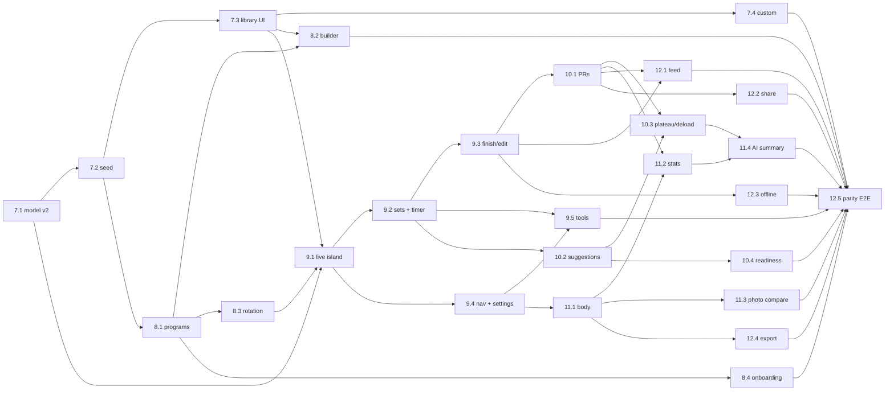

# Phase 2 Rounds — Hevy + Gravl Parity

Parent: [../readme.md](../readme.md) · Phase: 2 · Previous: [Phase 1 (MVP)](../phase-1/readme.md)

## Purpose

Phase 1 shipped the MVP: fixed routines, set logging, charts, family view, photos, nutrition, Supabase. Phase 2 makes gym-up a daily driver that can replace **Hevy** (logging, routines, records, stats, community) and **Gravl** (next workout, progression, deloads, readiness, recovery), without losing what is unique to gym-up (private photos, AI nutrition, family-first).

Product scope: [prd/overview.md → Phase 2](../../prd/overview.md#phase-2--hevy--gravl-parity). Decisions: [ADR-015 … ADR-026](../../architecture/decisions/readme.md). Schema: [database-schema.md → Phase 2 Migrations](../../architecture/database-schema.md#phase-2-migrations).

**Tie-break rule used to settle every open question in this phase:** do what Hevy does. If Hevy has no answer, do what Gravl does. If neither has one, choose the simplest option that keeps family visibility ([ADR-004](../../architecture/decisions/004-rls-visibility.md)).

---

## Phase Rules

### 1. Both backends, always

Phase 1 Round 6 made Supabase production. Every Phase 2 story that touches persistence MUST deliver, in the same story:

- the `db/schema.ts` change, plus `drizzle-kit generate` output in `db/migrations/`;
- the matching `supabase/migrations/0NN_*.sql`, including RLS;
- an `SqliteXxxRepository` and a `SupabaseXxxRepository` implementing the same abstract port ([ADR-007](../../architecture/decisions/007-repository-pattern.md), [ADR-011](../../architecture/decisions/011-implements-not-extends.md));
- wiring in the context's composition file, switched by `STORAGE_BACKEND` ([ADR-010](../../architecture/decisions/010-per-context-composition.md));
- for every owner-only or write-own table, an integration test **as a non-owner** under `tests/supabase/` (pattern: `rls-workout.integration.test.ts`).

### 2. Code is the source of truth for conventions

Context readmes were written before implementation. Where they disagree with the code, **the code wins**, and the story fixes the doc. Known drifts:

| Doc says | Code does |
|---|---|
| Svelte islands | React only (`.tsx`) — [ADR-015](../../architecture/decisions/015-live-workout-react-island.md) |
| snake_case domain types | Drizzle camelCase types from `@db/schema` |
| `getById`, `getByUserAndDate` | `findById`, `findEntries`, … (see `src/lib/contexts/*/domain/*.repository.ts`) |
| `src/test/...` | `tests/<context>/...` |
| `@/lib/config` | `src/lib/db/client.ts` + per-context `*.composition.ts` |
| `HealthRules` (system.md) | Does not exist yet. Story 10.2 creates `src/lib/health-safety/health-safety.constants.ts` |
| ADR-014 `gemini-2.5-flash` | `AIAnalysisRules.DefaultModel` in code. The weekly summary reuses that constant |

### 3. No mocks

Tests use real SQLite repositories and Object Mothers ([ADR-009](../../architecture/decisions/009-object-mothers.md)). Pure domain modules (progression, records, reducer, recovery) get exhaustive table-driven tests.

### 4. Islands

Interactive UI uses React islands only. Static UI uses Astro. Islands never import repositories; they call `src/pages/api/**`, which call use cases from composition roots.

### 5. Copy and units

UI copy is **Spanish**. Exercise names are **English** ([OQ-001](../../planning/open-questions.md)). Weight is stored in kg and lengths in cm; display follows `weight_unit` ([ADR-006](../../architecture/decisions/006-kg-storage.md)).

### 6. Phase 1 compatibility

History is immutable. Phase 1 workouts must render correctly after every migration: names, sets and charts. Every migration story includes a regression test that loads a Phase 1 fixture DB (`tests/fixtures/phase-1.db`, created in story 7.1) and asserts that history, progress and family pages still return the same numbers.

### 7. Forward-compatible UI

A story may render data that a later story produces, such as PR counts (10.1) or the weekly streak (11.2). In that case it renders a neutral fallback: hide the column, or show the Phase 1 day streak. The later story then wires the real value, so no story blocks on a later one.

---

## Story Rule

Same as [Phase 1](../phase-1/readme.md#story-rule): the headers `## Summary`, `## Happy Path`, `## Acceptance Criteria`, `## Tasks`, and `## Implementation Evidence` when done. Phase 2 stories add `## Out of Scope` and `## Test Plan`.

## Frontmatter Rule

```yaml
---
story_id: "7.1"
round: "round-7"
phase: "phase-2"
parent_spec: "../../../architecture/contexts/workout-tracking/readme.md"
size: "L"
status: "ready"
started: "TBD"
completed: "TBD"
owner: "TBD"
implements:
  architecture_features: ["workout-tracking", "exercise-library"]
  prd_requirements: []
  architecture_decisions: ["ADR-016", "ADR-017"]
  flows: []
blocked_by: []
blocks: ["story-7.2", "story-9.1"]
---
```

Status values: `draft`, `ready`, `in-progress`, `blocked`, `completed`, `skipped`. Phase 2 stories start as `ready`, because every decision is settled in its ADR.

---

## Rounds

| Round | Goal (one testable capability) | Stories |
|---|---|---|
| [Round 7 — Exercise Library & Data Model v2](./round-7/readme.md) | The DB supports free workouts, set types, RPE and every exercise type, and the user can browse 100+ exercises and create custom ones | 7.1 – 7.4 |
| [Round 8 — Programs & Routines](./round-8/readme.md) | The user owns programs and routines, builds or adopts them, and the dashboard always shows the next routine | 8.1 – 8.4 |
| [Round 9 — Live Workout v2](./round-9/readme.md) | A Hevy-grade live session: edit exercises on the fly, set types, Previous, per-exercise timers, finish/edit/delete, new navigation, gym tools | 9.1 – 9.5 |
| [Round 10 — Progression](./round-10/readme.md) | PR badges, next-session load suggestions, plateau handling, deloads, readiness and recovery | 10.1 – 10.4 |
| [Round 11 — Body, Stats & Insights](./round-11/readme.md) | Body measurements, Hevy statistics, photo comparison, weekly AI coach summary | 11.1 – 11.4 |
| [Round 12 — Social & Platform](./round-12/readme.md) | Family feed with likes/comments, share image, offline PWA, CSV export, parity acceptance | 12.1 – 12.5 |

### All stories

| ID | Title | Size | Blocked by | Requirements | ADRs |
|---|---|---|---|---|---|
| [7.1](./round-7/story-7.1.md) | Workout data model v2 migration | L | — | prerequisite for FR-WT-018..045 | 016, 017 |
| [7.2](./round-7/story-7.2.md) | Exercise library seed (107 exercises) | M | 7.1 | FR-EL-010, FR-EL-011 | 017 |
| [7.3](./round-7/story-7.3.md) | Exercise library browse, detail & picker | M | 7.2 | FR-EL-001..005, NFR-EL-01 | 017 |
| [7.4](./round-7/story-7.4.md) | Custom exercises | S | 7.3 | FR-EL-006..009 | 017 |
| [8.1](./round-8/story-8.1.md) | Programs schema, templates seed, user migration | L | 7.2 | FR-RT-005, FR-RT-017 (data) | 018 |
| [8.2](./round-8/story-8.2.md) | Program & routine builder | L | 8.1, 7.3 | FR-RT-001..004, FR-RT-006..009 | 018 |
| [8.3](./round-8/story-8.3.md) | Next-workout rotation & dashboard | M | 8.1 | FR-RT-010..014 | 019 |
| [8.4](./round-8/story-8.4.md) | Onboarding questionnaire, recommendation & templates browser | M | 8.1 | FR-RT-015..017 | 019 |
| [9.1](./round-9/story-9.1.md) | Live workout island — session & exercises | L | 7.1, 7.3, 8.3 | FR-WT-018..026, FR-WT-038 | 015, 016 |
| [9.2](./round-9/story-9.2.md) | Set rows v2, Previous, RPE, per-exercise rest timer, cardio | L | 9.1 | FR-WT-027..034, FR-WT-043 | 015, 016 |
| [9.3](./round-9/story-9.3.md) | Finish, summary v2, edit/delete, save as routine, history v2 | M | 9.2 | FR-WT-035, 036, 039, FR-RT-018, FR-PR-018 | 016 |
| [9.4](./round-9/story-9.4.md) | Navigation v2, profile hub, training settings | M | 9.1 | FR-WT-037, 044, 045 | — |
| [9.5](./round-9/story-9.5.md) | Gym tools: plate calculator, warm-up generator, 1RM calculator | S | 9.2, 9.4 | FR-WT-040..042 | 020 |
| [10.1](./round-10/story-10.1.md) | Personal records engine & PR badges | M | 9.3 | FR-PR-008..011 | 020 |
| [10.2](./round-10/story-10.2.md) | Load suggestions (double progression) | M | 9.2 | FR-PG-001..005, FR-PG-013 | 021 |
| [10.3](./round-10/story-10.3.md) | Plateau detection & deload week | M | 10.1, 10.2 | FR-PG-006..008 | 021 |
| [10.4](./round-10/story-10.4.md) | Readiness check-in & muscle recovery | M | 10.2 | FR-PG-009..012 | 022 |
| [11.1](./round-11/story-11.1.md) | Body measurements | M | 9.4 | FR-BM-001..007, FR-BM-009 | 023 |
| [11.2](./round-11/story-11.2.md) | Statistics v2: exercise detail, weekly charts, muscle distribution, month calendar, weekly streak | L | 10.1, 11.1 | FR-PR-012..017 | 020 |
| [11.3](./round-11/story-11.3.md) | Progress photo comparison | S | 11.1 | FR-PP-008..010 | 005, 023 |
| [11.4](./round-11/story-11.4.md) | Weekly AI coach summary | M | 11.2, 10.3 | FR-PR-019, FR-PR-020 | 026 |
| [12.1](./round-12/story-12.1.md) | Family feed, workout detail, likes, comments, activity | L | 9.3, 10.1 | FR-SO-001..007, FR-SO-009, FR-PV-007..009 | 024 |
| [12.2](./round-12/story-12.2.md) | Share workout as image | S | 10.1 | FR-SO-008 | 024 |
| [12.3](./round-12/story-12.3.md) | PWA + offline live workout | L | 9.3 | NFR-WT-P2-01..05 | 025 |
| [12.4](./round-12/story-12.4.md) | CSV export (workouts + measurements) | S | 11.1 | FR-PR-021, FR-BM-008 | — |
| [12.5](./round-12/story-12.5.md) | Phase 2 parity acceptance (E2E) | S | all | Exit criteria below | — |

### Dependency graph



> Story 12.5 is blocked by every other story. Individual `blocks` lists omit it on purpose, to avoid listing it 25 times. Story 12.2 also needs 12.1 (it uses the social context's `GenerateShareImageDataUseCase`).

**Critical path:** 7.1 → 7.2 → 7.3 → 9.1 → 9.2 → 9.3 → 10.1 → 11.2 → 11.4 → 12.5. Rounds 8 and 9.4 can run in parallel with 9.1 once their blockers close.

---

## Phase 2 Decisions and Resolved Spec Conflicts

The context readmes, components.md and the stories were written in parallel and disagreed on details. These are the **binding resolutions**. Where a document still says otherwise, this table wins and the owning story fixes the document (task "Update docs").

| # | Conflict | Resolution |
|---|---|---|
| D1 | Which doc wins on file paths and props: `components.md` or a context readme | **The context readme.** components.md is the component catalogue; it follows the readme on `.astro` vs `.tsx`, file paths and props. Where the readme and components.md differ (FeedList, TabBar, NextWorkoutCard, picker paths), implement what the readme says and fix components.md in the same story |
| D2 | `DEFERRABLE` mode on routine uniqueness | `INITIALLY IMMEDIATE`. Reorder is a single `UPDATE … CASE` (database-schema.md §006) |
| D3 | Rotation anchor | `routines.rotation_anchor_at` everywhere. `routines.updated_at` is never the anchor |
| D4 | SQL functions of migrations 004 and 006 | Full list with owning story in database-schema.md (§004, §006). Functions only ship together with a caller and a test |
| D5 | Ownership violation status code | `403` (as Phase 1) |
| D6 | lb ↔ kg conversion | Exact `0.45359237`, shared helper `src/lib/units/weight.ts` created in story 9.4; Phase 1 pages migrate in 9.4. ADR-006 updated |
| D7 | Max plates in settings | 12 distinct values (user context readme) |
| D8 | Settings and `routineType` | The routine-type radio is removed from Settings (9.4). `UpdateProfileUseCase` no longer accepts `routineType`; `profiles.routine_type` stays as an onboarding hint only |
| D9 | `/train` page owner | Story 8.2 creates it. Story 9.4 creates a minimal version only if 8.2 has not shipped, and 8.2 replaces it |
| D10 | `e1rm()` home | Story 9.5 creates `src/lib/contexts/progress/domain/personal-records.ts` with only `e1rm()` and `RecordRules`; story 10.1 extends the same file |
| D11 | Tabs on the exercise detail page | A tab whose story has not shipped is **not rendered** (no placeholders). 7.3 ships *Cómo hacerlo*; 10.1 adds *Récords*; 11.2 adds *Historial* and *Gráficas* |
| D12 | Who wires the weekly streak | 11.2 exports `CalculateWeeklyStreakUseCase` and wires `/profile`; 12.1 wires the member card (FR-PV-008). Until then the Phase 1 day streak shows (rule 7) |
| D13 | `StatsQueryRepository` / `StatsProfilePort` ownership | Created by the first story that needs them (10.1); later stories extend them |
| D14 | History use case | Phase 1 `GetWorkoutHistoryUseCase` (workout-tracking) is extended in 9.3 with filters; PR counts join in once 10.1 lands (rule 7). The progress readme's `GetHistoryUseCase` name refers to that same use case |
| D15 | Endpoint the island uses for per-exercise data | `/api/workouts/[id]/exercise-context` (workout-tracking). It aggregates catalogue, previous values, suggestion and PR baseline. The progress and progression endpoints serve pages |
| D16 | Where the `*.instance.ts` modules sit | Cross-context ports are exported from the provider's `*.instance.ts` (no cycle with `*.composition.ts`), as the routines readme prescribes; the workout-tracking readme follows it |
| D17 | `ProgressionInsightsPort` ships in | 10.3 (11.4 depends on 10.3, not on 10.4) |
| D18 | Navigation flags | 9.4 introduces `ShellFeatures` flags (progress, body metrics, activity…). 9.4 turns on the flags for what Round 8 already shipped; stories 10.3, 11.1, 11.2 and 12.4 flip the flag for what they ship |
| D19 | CSV export of `duration` exercises | `weight_kg` is exported whenever the set has a weight; `duration_seconds` always when present |
| D20 | E2E auth with `STORAGE_BACKEND=supabase` | Auth composition is SQLite-only today. Story 12.5 first checks it; if confirmed, it adds a `SupabaseAuthService` wiring task before the Supabase parity run. Tracked as a risk |

---

## Exit Criteria — Hevy + Gravl Parity

Phase 2 is **done** when story 12.5's E2E suite passes every row below on both `STORAGE_BACKEND=sqlite` and `supabase`.

### Hevy

| # | Capability | Story |
|---|---|---|
| H1 | Start an empty workout or any routine; repeat a past workout | 9.1 |
| H2 | Add / remove / reorder / replace exercises mid-workout | 9.1 |
| H3 | Supersets | 9.1, 9.2 |
| H4 | Set types (warm-up, drop, failure) | 9.2 |
| H5 | "Previous" column per set | 9.2 |
| H6 | RPE per set (optional) | 9.2 |
| H7 | Per-exercise rest timer with notification | 9.2 |
| H8 | Bodyweight, assisted, timed and distance exercises (cardio) | 7.1, 9.2 |
| H9 | Elapsed time, volume and sets live | 9.1 |
| H10 | Finish with summary; edit and delete past workouts | 9.3 |
| H11 | 100+ exercise library with instructions, search and filters | 7.2, 7.3 |
| H12 | Custom exercises | 7.4 |
| H13 | Routine builder with programs (folders), rep ranges, rest, supersets, notes | 8.2 |
| H14 | Copy routines (templates and family) | 8.1, 8.2 |
| H15 | Save a workout as a routine | 9.3 |
| H16 | Personal records with live badges and a rep-max table | 10.1 |
| H17 | Exercise charts, history and records tabs | 11.2 |
| H18 | Weekly charts, muscle distribution, month calendar, weekly streak | 11.2 |
| H19 | Body weight and measurements with charts | 11.1 |
| H20 | Feed with likes and comments | 12.1 |
| H21 | Share a workout as an image | 12.2 |
| H22 | Plate calculator, warm-up calculator, 1RM calculator | 9.5 |
| H23 | Works offline; installable | 12.3 |
| H24 | CSV export | 12.4 |

### Gravl

| # | Capability | Story |
|---|---|---|
| G1 | Onboarding questionnaire → recommended program | 8.4 |
| G2 | "Next workout" always ready (rotation, no weekday binding) | 8.3 |
| G3 | Next-session weight/reps suggestion with explanation | 10.2 |
| G4 | Plateau detection with options | 10.3 |
| G5 | Deload weeks | 10.3 |
| G6 | Readiness check-in that adapts the session | 10.4 |
| G7 | Muscle recovery map | 10.4 |
| G8 | Weekly coach summary | 11.4 |

### gym-up unique (regression)

| # | Capability | Story |
|---|---|---|
| U1 | Private progress photos + comparison | 11.3 (+ Phase 1 4.2) |
| U2 | AI nutrition from a photo | Phase 1 Round 5 (regression only) |
| U3 | Family visibility with private data never leaking | 12.1, 12.5 |
